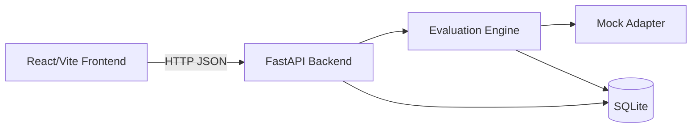

# TraceForge

TraceForge is a local-first AI evaluation and observability tool. It runs a FastAPI backend with SQLite and a Vite/React/TypeScript/Tailwind frontend.

## Value proposition

TraceForge helps engineers evaluate deterministic AI outputs, inspect traces, and compare evaluation runs entirely on a local machine without cloud dependencies.

## Problem

Evaluating AI-style outputs often requires external services, paid APIs, or opaque tooling. TraceForge provides a self-contained, reproducible workflow for running deterministic mock evaluations, inspecting per-case results and traces, and comparing runs locally.

## Core capabilities

- Project, dataset, and test case management
- Deterministic mock evaluation runs with five profiles: `correct`, `incorrect`, `invalid_json`, `empty`, `error`
- Per-case pass/fail results, scores, latency, and errors
- Trace and span inspection with hierarchy and parent references
- Run comparison with pass-rate delta, regressions, and improvements
- Project metrics and dashboard
- Responsive frontend with loading, empty, and error states

## Architecture



## Stack

- Backend: FastAPI, SQLAlchemy, SQLite, Pydantic
- Frontend: React, Vite, TypeScript, Tailwind CSS
- Evaluation: deterministic mock adapter
- Tests: pytest, Vitest, TypeScript checks, Ruff, Oxlint

## Prerequisites

- Python 3.11+
- Node.js 20+

## Setup

Backend (Windows PowerShell):

```powershell
cd backend
python -m venv .venv
.\.venv\Scripts\Activate.ps1
pip install -e .
python -m uvicorn app.main:app --host 127.0.0.1 --port 8000
```

Frontend (separate terminal):

```bash
cd frontend
npm install
npm run dev
```

Frontend URL: http://localhost:5173  
Backend URL: http://127.0.0.1:8000  
API docs: http://127.0.0.1:8000/docs

## Deterministic mock adapter

The mock adapter returns fixed outputs per profile (`Paris` for `correct`, `wrong answer` for `incorrect`, `{not valid json` for `invalid_json`, empty string for `empty`, and raises for `error`). It does not call any external model or service. Latency can be simulated via `simulated_latency_ms`.

## Persistence and seeding

SQLite is used by default (local file). On startup, tables are created and demo data is seeded only when the database has no projects and `seed_demo` is enabled.

## Tests and checks

Frontend:

```bash
cd frontend
npm run lint
npm run test
npm run build
npx tsc -b
```

Backend:

```bash
cd backend
pytest
ruff check .
```

## Limitations

- Only a deterministic mock adapter is implemented; no real external AI model evaluation.
- No authentication, multi-user support, or production deployment configuration.
- SQLite is intended for local development only.
- Browser-based end-to-end testing was not performed.
- Screenshots are not included; see [docs/screenshots.md](docs/screenshots.md).
```

## Manual screenshot checklist

1. Overview dashboard
2. Evaluation run details
3. Trace viewer
4. Run comparison
